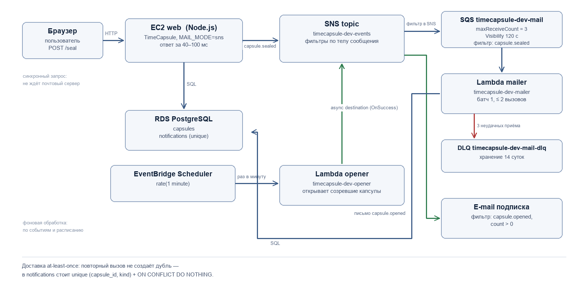

# TimeCapsule — приложение и документация (ЛР7, часть 2)

Веб-приложение «капсулы времени» на Node.js/Express, которое в этой версии перестало
делать медленную работу внутри HTTP-запроса:

* `POST /seal` только пишет капсулу в PostgreSQL и публикует событие `capsule.sealed`
  в SNS — ответ занимает **40–100 мс** вместо **5 с**;
* письмо о запечатанной капсуле отправляет Lambda `timecapsule-dev-mailer`
  (очередь `timecapsule-dev-mail` + DLQ);
* капсулы открывает Lambda `timecapsule-dev-opener` по расписанию EventBridge
  (раз в минуту), а не первый посетитель сайта.



## Состав репозитория

| Путь | Что это |
|---|---|
| `server.js` | приложение: режимы `MAIL_MODE=inline` (замер «до») и `sns` |
| `schema.js`, `sql/schema.sql` | миграция: `capsules.opened_at`, таблица `notifications` |
| `deploy.sh` | раскатка на EC2 (`bash deploy.sh sns`) |
| `docs/events.md` | контракты событий `capsule.sealed` и `capsule.opened` |
| `docs/adr/0006-background-jobs.md` | ADR: почему SNS + SQS + Lambda, а не другие варианты |
| `docs/architecture.png` | схема фоновой обработки |
| `tools/draw_architecture.py` | генератор схемы (Pillow) |

Обработчики лежат в отдельных репозиториях:
`timecapsule-mailer` и `timecapsule-opener`.

## Режимы отправки почты

`MAIL_MODE=inline` — прежнее поведение: `POST /seal` ждёт «почтовый сервер»
(`MAIL_DELAY_SECONDS = 5`) и только потом отвечает. Нужен, чтобы измерить «до».

`MAIL_MODE=sns` — приложение публикует событие в тему `timecapsule-dev-events`
и сразу отвечает. Ключ доступа не используется: на EC2 приложение работает под
ролью инстанса, у роли есть только `sns:Publish` на эту тему.

## Эндпоинты

| Метод | Путь | Назначение |
|---|---|---|
| GET | `/` | список капсул и уведомлений, форма запечатывания |
| POST | `/seal` | запечатать капсулу (и опубликовать `capsule.sealed`) |
| GET | `/health` | состояние БД, зона, текущий режим почты |
| GET | `/capsules` | JSON со списком капсул |
| GET | `/notifications.json` | JSON с уведомлениями |
| GET | `/whoami` | сессия и имя сервера |

## Переменные окружения

См. `.env.example`. Секретов в репозитории нет; на сервере значения лежат в `.env`
(файл в `.gitignore`) и в переменных окружения Lambda.

## Схема БД

```sql
alter table capsules add column if not exists opened_at timestamptz;

create table if not exists notifications (
  id            bigserial primary key,
  capsule_id    integer not null,
  user_id       integer not null,
  kind          varchar(16) not null,      -- sealed | opened
  capsule_title varchar(200) not null,
  created_at    timestamptz not null default now(),
  unique (capsule_id, kind)                -- идемпотентность
);

create index if not exists capsules_due_idx on capsules (open_at) where opened_at is null;
```

## Результаты замеров

| Сценарий | Время `POST /seal` |
|---|---|
| `MAIL_MODE=inline` (почта внутри запроса) | 5 007–5 015 мс |
| `MAIL_MODE=sns` (событие в SNS) | 40–102 мс |

Капсула 34: `open_at = 14:19:15 UTC`, `opened_at = 14:19:53 UTC` — открыта
расписанием, пока на сайт никто не заходил.
