# Отчёт по лабораторной работе № 7

**Бессерверные вычисления и события: AWS Lambda, Amazon SQS, Amazon SNS**

* Выполнила: студентка гр. IA-2404 Берлинская Дарья
* Специальность: прикладная информатика
* Уровень: продвинутый (части 1–2, задания 1–10)
* Репозиторий приложения: <https://github.com/burningdora/timecapsule-app>

## 1. Цель работы и постановка задачи

Цель — убрать медленную работу из HTTP-запроса и построить отказоустойчивую
обработку событий на управляемых сервисах AWS: связать тему SNS, очередь SQS
и функцию Lambda, настроить фильтры, журналы и очередь необработанных сообщений.

Задачи: создать тему, очередь с DLQ и Lambda-обработчик и проверить повторные
вызовы; настроить фильтр отрицательных отзывов и письмо на e-mail; вынести
отправку письма о запечатанной капсуле в очередь и Lambda; открывать созревшие
капсулы по расписанию EventBridge и отправлять результат в SNS; измерить время
ответа до и после, проверить идемпотентность и поведение при сбое.

Выполнены обе части работы, задания 1–10.

## 2. Условия выполнения

Работа выполнена в учебном аккаунте AWS, регион `eu-central-1` (Франкфурт),
под IAM-пользователем. Ключи доступа в коде, на серверах и в репозиториях не
используются: приложение на EC2 работает под ролью инстанса, функции — под ролями
выполнения. Сеть и база взяты из ЛР3–ЛР5: VPC `10.17.0.0/16`, RDS PostgreSQL
`timecapsule-dev-rds`, веб-сервер `timecapsule-dev-web` с приложением TimeCapsule
на Node.js. Ресурсы части 1 имеют префикс `lab7-`, части 2 — имена из задания;
все помечены тегом `Lab=lab7`. Почта для проверки — внешний ящик mail.tm, пароль
в отчёт не входит.

## 3. Часть 1. SNS, SQS и Lambda

Отзывы публикуются в тему `lab7-reviews`. Очередь `lab7-reviews-queue` накапливает
их и запускает функцию `lab7-review-worker`, а письмо о плохом отзыве получает
подписчик с фильтром.

### 3.1 Параметры темы, очереди и функции

| Компонент | Значение |
|---|---|
| Тема SNS | `lab7-reviews`, standard, `eu-central-1` |
| Подписка очереди | `lab7-reviews-queue`, raw message delivery = true, без фильтра |
| Очередь | standard, `VisibilityTimeout` 30 с, хранение 4 суток |
| DLQ | `lab7-reviews-dlq`, `maxReceiveCount` = 3 |
| Функция | `lab7-review-worker`, Python 3.12, 128 МБ |
| Триггер SQS | batch size 10, окно батча 10 с |
| Роль | `lab7-review-worker-role`: журналы, приём и удаление из очереди |
| Подписка e-mail | фильтр `{"rating":[{"numeric":["<=",2]}]}` |
| Тег | `Lab=lab7` |

`VisibilityTimeout` 30 с больше времени работы функции, поэтому сообщение не
возвращается, пока обработчик занят; хранение 4 суток даёт запас на разбор DLQ,
`maxReceiveCount` = 3 — три попытки. Raw delivery включён: в очередь попадает сам
JSON, и функция читает поля напрямую; без него тело было бы конвертом SNS с
`Message` и `Signature`. Сообщение снова становится видимым, потому что SQS лишь
скрывает его на `VisibilityTimeout`, а удаляет только после `DeleteMessage`.

### 3.2 Повторные вызовы и DLQ

Чтобы увидеть повторные вызовы, в очередь отправили отзыв `r-4` без поля `text`.
Обработчик трижды завершился ошибкой `KeyError: 'text'` — в журнале видны вызовы
17:16:22, 17:17:06 и 17:18:02 (рис. 1). SQS увеличивал счётчик приёма, и после
третьей неудачной попытки сообщение с `Receive count` 4 оказалось в DLQ (рис. 2).

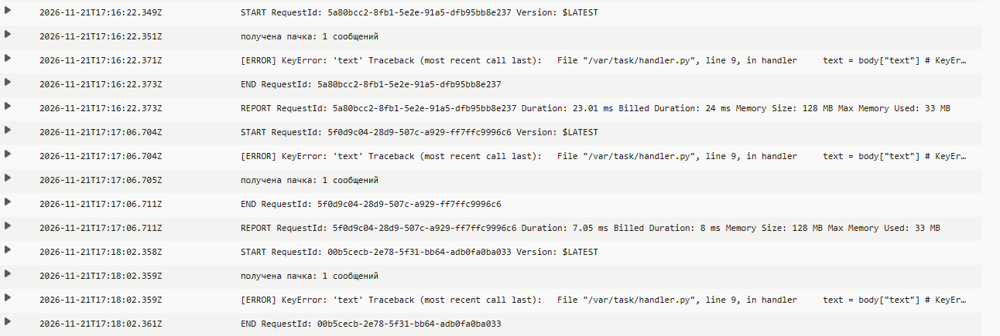

*Рисунок 1 — Журнал `lab7-review-worker`: три неудачных вызова r-4 с ошибкой
`KeyError: 'text'` (17:16–17:18 UTC).*

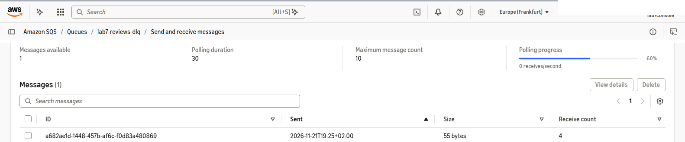

*Рисунок 2 — Сообщение r-4 в очереди `lab7-reviews-dlq`: `Receive count` = 4,
размер 55 байт.*

После исправления обработчика (отсутствие `text` стало допустимым) выполнили
redrive из DLQ: сообщение вернулось в очередь и было обработано —
`r-4: 4/5 (без текста)`. Повторная обработка не создала второго уведомления.

Три отзыва r-5…r-7 дали три вызова: batch size 10 задаёт максимум, но не ждёт
заполнения; после включения окна 10 с r-9 и r-10 обработались одной пачкой. При
ошибке в одном сообщении пачки Lambda по умолчанию возвращает всю пачку, поэтому
успешные сообщения обработаются повторно — нужна идемпотентность или
`batchItemFailures`.

### 3.3 Фильтр и письмо о плохом отзыве

Вторая подписка темы — e-mail с фильтром `rating <= 2`. Из четырёх опубликованных
отзывов письмо получил только r-21 с оценкой 1; отзывы r-22 (3), r-23 (5) и r-24
без атрибута `rating` остались без письма. При этом очередь подписана без фильтра,
поэтому worker обработал все четыре отзыва (табл. 2). Письмо получено 21.11.2026
в 17:25:55 UTC (рис. 3).

| Отзыв | Почта (фильтр rating ≤ 2) | Журнал `lab7-review-worker` |
|---|---|---|
| rating = 1 (r-21) | да, письмо 17:25:55 | да, `1/5 Terrible packaging…` |
| rating = 3 (r-22) | нет | да, `3/5 Average quality…` |
| rating = 5 (r-23) | нет | да, `5/5 Perfect, fast…` |
| без rating (r-24) | нет | да, `4/5 No rating attribute…` |

*Таблица 2 — Куда попал каждый отзыв (задание 4).*

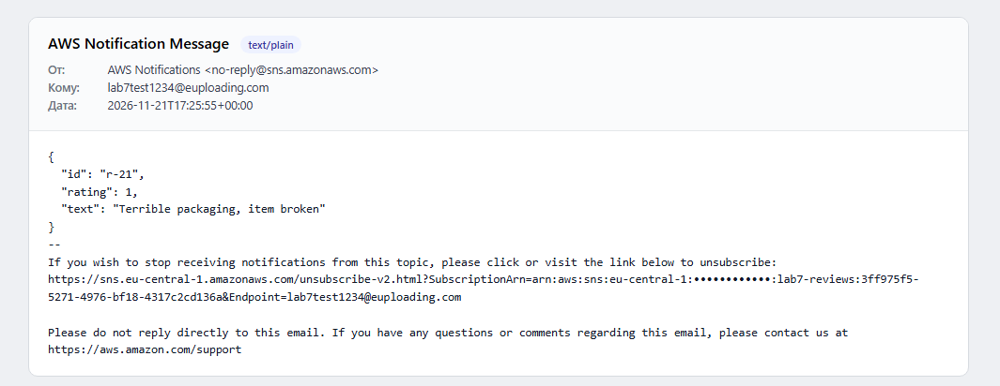

*Рисунок 3 — Письмо о плохом отзыве r-21, отобранное фильтром подписки (вид
письма восстановлен из сохранённого ответа API почтового ящика).*

Отзыв без атрибута не прошёл фильтр: условие применяется к `rating`, а у r-24 его
нет. Если бы издатель отправлял отзывы в каждую очередь напрямую, каждый новый
получатель требовал бы правки кода; с темой достаточно добавить подписку и фильтр.

После проверки все ресурсы части 1 удалены: функция, триггер, журналы, тема,
очередь, DLQ и роль. Часть 2 начиналась с чистой конфигурации.

## 4. Часть 2. Фоновая обработка TimeCapsule

Во второй части приложение перестало делать медленную работу внутри запроса.
`POST /seal` пишет капсулу в RDS и публикует событие `capsule.sealed` в тему
`timecapsule-dev-events`; письмо отправляет Lambda `timecapsule-dev-mailer` из
очереди, а созревшие капсулы открывает `timecapsule-dev-opener` по расписанию
(рис. 4).

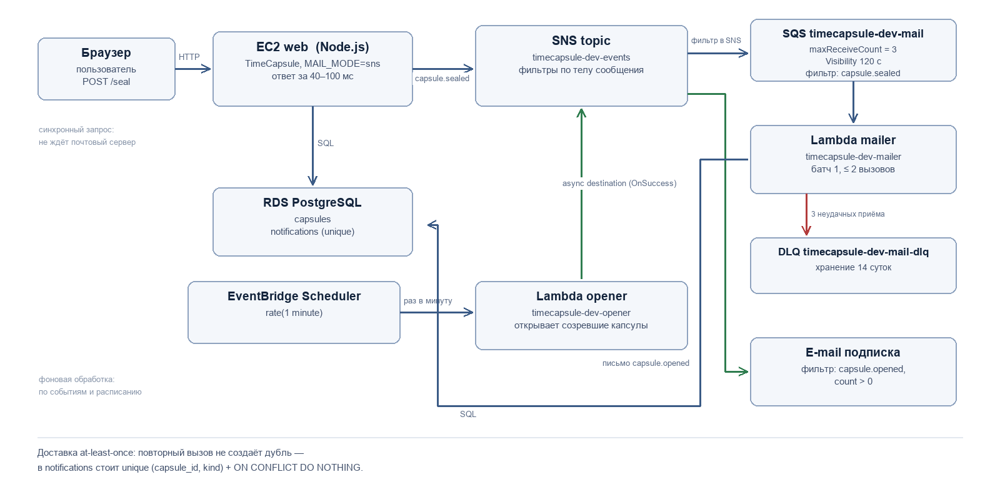

*Рисунок 4 — Схема фоновой обработки TimeCapsule (источник:
`docs/architecture.png`).*

### 4.1 Архитектура и замеры

На схеме два независимых потока: событие запечатывания и вызов по расписанию.
Приложение работает под ролью инстанса и имеет только право `sns:Publish` на тему;
функции подключены к приватным подсетям, имеют доступ к RDS по 5432 через группу
`timecapsule-dev-lambda-sg` и получают параметры БД из переменных окружения.

| Режим | Как отправляется письмо | Время ответа |
|---|---|---|
| `MAIL_MODE=inline` (до) | синхронно, задержка 5 с внутри запроса | 5 015 мс |
| `MAIL_MODE=sns` (после) | публикация события, письмо в фоне | 40–102 мс |

*Таблица 3 — Время ответа `POST /seal` до и после переноса почты.*

Замеры сделаны в панели Network браузера: 5,19 с до и 102 мс после (рис. 5);
серверный замер дал 5 015 и 40 мс. Если mailer не работает, пользователь всё равно
получает ответ: событие лежит в очереди до 4 суток. Ошибка публикации в SNS сразу
возвращает ошибку запроса, хотя капсула уже записана.

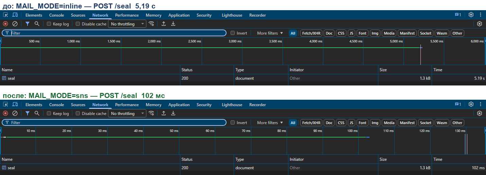

*Рисунок 5 — Панель Network до и после: один и тот же запрос `POST /seal`.
Приложение открыто по имени `timecapsule.test`, сопоставленному с публичным IP
параметром Chrome: антивирус блокировал прямой HTTP-доступ по IP; подписи
«до/после» добавлены.*

### 4.2 Расписание и открытие капсул

Расписание `timecapsule-dev-open-capsules` с выражением `rate(1 minute)` вызывает
opener каждую минуту; роль планировщика имеет право только на эту функцию (рис. 6).
Функция одним запросом `UPDATE capsules SET opened_at = now() WHERE open_at <= now()
AND opened_at IS NULL` открывает все созревшие капсулы.

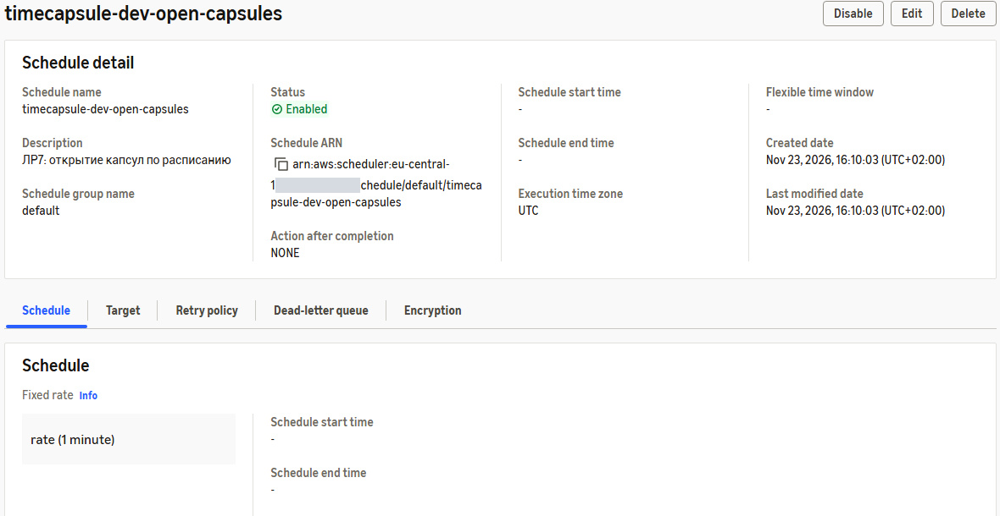

*Рисунок 6 — Расписание `timecapsule-dev-open-capsules`: `rate(1 minute)`, статус
Enabled (номер аккаунта в ARN закрыт).*

Капсула 33 с `open_at` 14:14:39 открылась в 14:14:53, капсула 34 с `open_at`
14:19:15 — в 14:19:53, хотя на сайт никто не заходил. Задержка 14–38 с объясняется
минутным шагом расписания. Результат вызова уходит в тему асинхронным назначением
«при успехе» (OnSuccess, рис. 7); подписка на e-mail фильтрует полный конверт по
вложенному полю `responsePayload`: `event = capsule.opened` и `count > 0`, поэтому
пустые вызовы не превращаются в письма.

Если назначение не доставило запись в тему, Lambda повторяет вызов и хранит
запись; после исчерпания попыток её можно направить в DLQ назначения. Если бы
функция публиковала сама, понадобились бы NAT-шлюз и политика `sns:Publish`, а
трафик NAT оплачивался бы отдельно; расписание можно заменить отложенной
доставкой в SQS (до 15 минут) или cron на EC2.

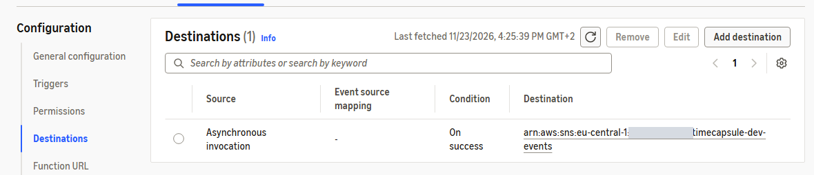

*Рисунок 7 — Асинхронное назначение opener: при успехе — тема
`timecapsule-dev-events`.*

### 4.3 Письмо об открытии

Письмо об открытии капсулы 34 пришло в 14:19:53. В `responsePayload` видно
`capsule_id` 34, `open_at` и `opened_at` (рис. 8), то есть цепочка «расписание →
opener → назначение → подписка» работает целиком.

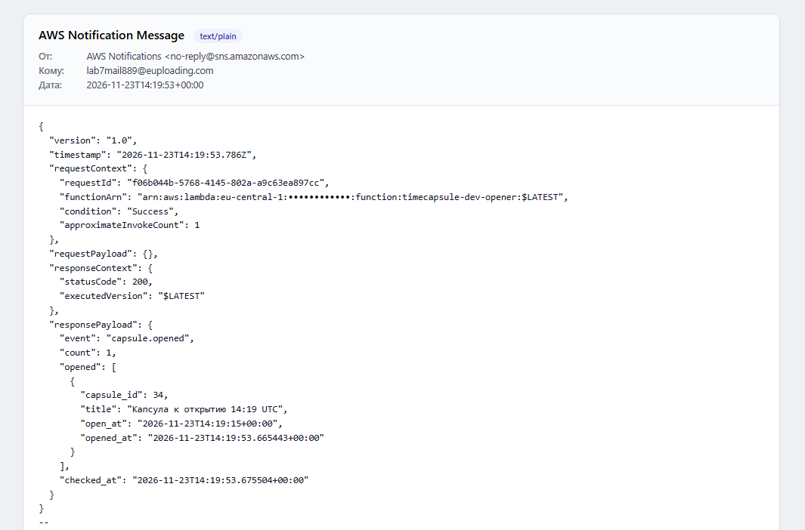

*Рисунок 8 — Письмо `capsule.opened`: конверт вызова и результат opener (вид
письма восстановлен из сохранённого ответа API; номер аккаунта закрыт).*

### 4.4 Сбой, DLQ и повторная обработка

Для проверки DLQ в переменных окружения mailer испортили пароль БД. Два сообщения
(капсулы 35 и 36) прошли три неудачных приёма с `OperationalError`; на графиках
очередь показывает два сообщения «в полёте» и рост возраста старейшего (рис. 9),
а в DLQ оказалось два сообщения (рис. 10). В журнале mailer при этом видны
повторные `OperationalError`; текст ошибки обрезан шириной колонки консоли.

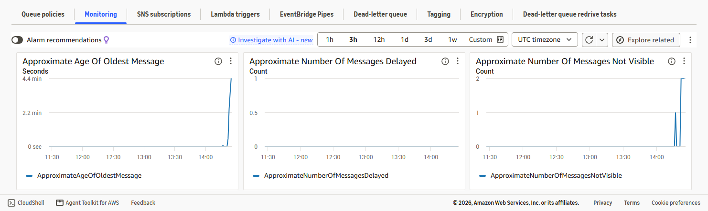

*Рисунок 9 — Метрики `timecapsule-dev-mail` во время сбоя: 2 сообщения Not
Visible, возраст старейшего растёт.*

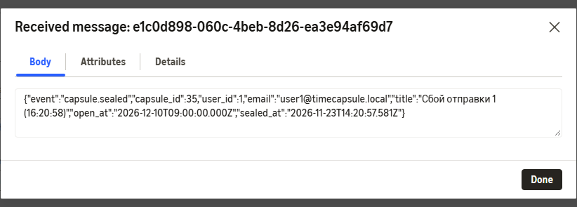

*Рисунок 10 — Сообщение капсулы 35 в `timecapsule-dev-mail-dlq` с телом события
`capsule.sealed`.*

Пароль восстановили, дождались `VisibilityTimeout` и выполнили redrive. Оба
сообщения обработались: в журнале «капсула 35/36: письмо записано», в таблице
`notifications` — ровно по одной строке `sealed` на капсулу (рис. 11). Дублей нет
благодаря ограничению `unique (capsule_id, kind)` и `ON CONFLICT DO NOTHING`.
Отдельно идемпотентность проверили четырьмя доставками одного сообщения: «письмо
записано» появилось один раз, остальные — «письмо уже было (дубль)». Параллелизм
mailer ограничен `MaximumConcurrency` = 2: резервированную конкурентность в учебном
аккаунте выделить нельзя (квота 10).

В ЛР6 та же поломка вернула бы 500 на `POST /seal`: письмо не записалось бы и не
повторилось — у синхронного вызова нет ни очереди, ни DLQ.

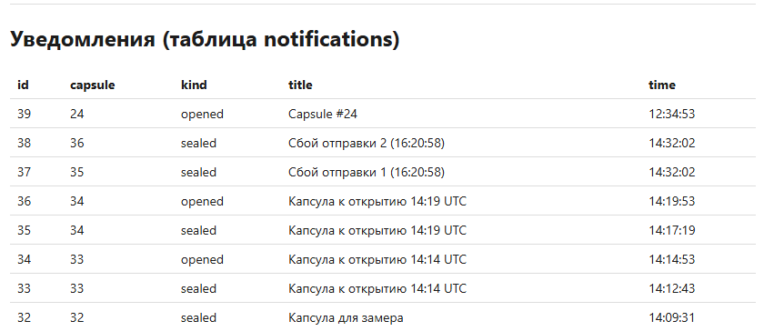

*Рисунок 11 — Таблица `notifications`: по одной строке sealed и opened на капсулы
33, 34 и по одной sealed на 35, 36.*

### 4.5 Репозитории и документация

Код и документация опубликованы в трёх публичных репозиториях; секретов в них нет.

* <https://github.com/burningdora/timecapsule-mailer> — обработчик очереди писем;
* <https://github.com/burningdora/timecapsule-opener> — открытие капсул по расписанию;
* <https://github.com/burningdora/timecapsule-app> — приложение,
  [docs/events.md](../events.md) и [ADR-0006](../adr/0006-background-jobs.md).

В `docs/events.md` описаны контракты `capsule.sealed` и `capsule.opened`, гарантии
at-least-once, фильтры и разбор DLQ. Для письма получателю нужны `capsule_id`,
`email`, `title` и `open_at`; пароль БД и служебные поля в событие не попадают.
Решение и отвергнутые альтернативы (SNS → Lambda без очереди, Step Functions, cron
на EC2) зафиксированы в ADR-0006.

## 5. Контрольные вопросы

**1. Как происходит событие, начинающееся с нажатия Seal capsule, до строки
в `notifications`? Где оно может сохраниться, а где может быть потеряно?**

`POST /seal` записывает капсулу в RDS и публикует `capsule.sealed` в SNS; тема
передаёт событие подписанной очереди, SQS хранит его до вызова Lambda, а mailer
вставляет строку в `notifications`. После SNS событие живёт в очереди до 4 суток
и переживает сбой функции; потерять его можно только при ошибке публикации, а от
дублей защищает `unique (capsule_id, kind)`.

**2. Чем очереди SQS отличаются от тем SNS и почему обе необходимы в этой работе?**

SNS работает по модели публикации и подписки: одно сообщение получают все
подходящие подписчики, а фильтры отсекают лишнее. SQS — очередь: она хранит
сообщение до обработчика, сглаживает всплески и даёт повторные приёмы с DLQ. SNS
распределяет событие между очередью и почтой, а SQS защищает mailer от потери
и перегрузки.

**3. Какую работу с SQS и SNS выполняет сервис Lambda для функций в VPC и почему
им не требуется доступ в Интернет?**

Служба Lambda сама опрашивает SQS от имени роли выполнения, собирает пачки,
вызывает функцию и удаляет сообщения после успеха; она же доставляет записи
асинхронных вызовов в SNS-назначение. Функция только открывает соединение с RDS
внутри VPC, поэтому интернет ей не нужен. Если бы она публиковала в SNS сама,
понадобился бы NAT-шлюз.

**4. Как изменилась архитектура приложения по сравнению с ЛР2? Что перешло на AWS
и какие появились возможности?**

В ЛР2 вся работа шла в одном веб-процессе; теперь запрос только пишет капсулу и
публикует событие, а письмо и открытие капсул вынесены в Lambda. SQS буферизует
сообщения и даёт DLQ, SNS раздаёт события подписчикам, EventBridge открывает
капсулы без посетителей. Появились быстрый ответ и повторная обработка без потери
писем.

## 6. Стоимость и уборка ресурсов

Стоимость близка к нулю: SNS, SQS и Lambda оплачиваются по факту (единицы сообщений
и сотни вызовов), RDS и EC2 работали только во время проверок. После работы
удалены расписание, триггер, назначение, подписки, функции, очередь, DLQ, тема,
роли и правило группы безопасности; ночная остановка RDS включена, RDS, веб-сервер
и бастион остановлены. Секретов в отчёте и репозиториях нет: пароли хранятся
в переменных окружения и `.env` (в `.gitignore`), ключи доступа не использовались,
номер аккаунта на рисунках закрыт.

## 7. Выводы

Запрос теперь только фиксирует данные, а почта и открытие капсул идут фоново.
`POST /seal` ускорился с 5 с до 40–102 мс, капсулы открываются без посетителей,
сбой БД не теряет сообщения, повторная доставка не создаёт дублей. Ресурсы удалены
или остановлены.
